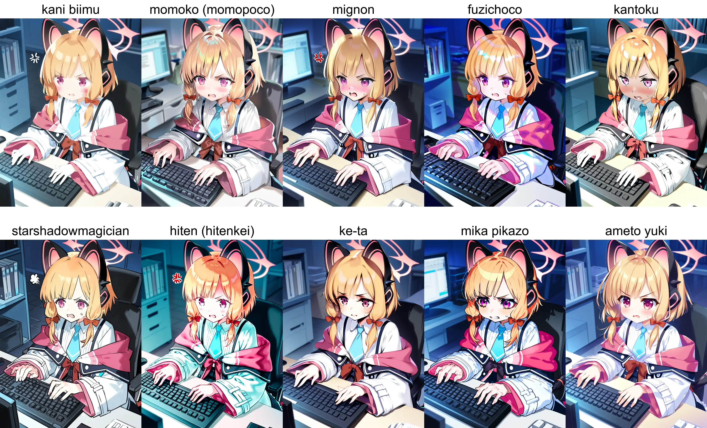

# 【RU9M】更快的扩散模型画风蒸馏！

大家有用过[RUM](https://github.com/RimoChan/RUM)吗？

之前的RUM是将动漫模型能力迁移到新模型上，不过训练还是偏慢。

最近有新出了1些不错的base model，比如krea2和moss，甚至它们本身就带有1些画动漫角色的能力，不过没有支持画风，那是不是有成本更低的方式可以把画风的能力迁移到新模型上呢？

有的！

聪明的莉沫酱最新发明的RU9M正要来解决这个问题！


## 原理

训练的时候我们通常是需要1个图和1个prompt做配对对吧，但prompt和图本身是永远对不齐的，比如图中是「白衬衫」，prompt是「衬衫」，我想让模型学习图片中的画风因此在「衬衫」后加上了`[V]`，结果模型可能反而把「白」学会了。

对于prompt来说，标注得越细致，新标记的占比就越小，标注得越粗糙，prompt和图像的偏差就越大。

那怎么办呢？

我们可以反过来想，先确定prompt，然后直接用prompt生成对应图片，他们不就对应上了吗？等等，听起来很好，可是那`[V]`怎么办？模型就是不会`[V]`才要去学啊，它能画那还学什么？

那有没有办法在不改变图片原有内容的情况下，把`[V]`添加上去呢？在画风作为`[V]`的场景中，我们1直都有1个这样的手段，那就是图像重绘！

所以流程就是这样，首先做1个简短的`prompt+V`，随机选噪声`N1`，用MOSS生成图片`A1`，然后把`prompt+V`和图片`A1`送进SDXL加0.8的噪声`N2`生成图片`A2`，训练的时候就输入`prompt+V`和`N1`，结果对`A2`作loss，这样就可以了。


## 效果

权重我放在在HF了，大家可以去<https://huggingface.co/rimochan/ru9moss>下载！

效果是这样:



因为还在测试阶段，所以现在训的这个版本不是dan上全部的画风，而是从群友处收集的128个常用画风，列表在[这里](./赠品/好画师.json)。

不过考虑到大家的画师串都是抄来抄去的，128个大抵也够用了吧！


## 成本

之前训RUM的时候花了$600，但当时RTX5090租1天只要$5，现在涨价了不少，1天要$12，好贵！

刷数阶段我先是刷了11500张图，这些花了3天。然后5090单卡1天能跑38k个step，训了4.5天，所以总的成本只要$90，有了这样低成本的方式，大家就都可以在家训练啦！

此外，在5090和4090上都有验证过能跑，5090的速度是4090的1.47倍。因为embedding是提前刷过的，训练阶段不需要TE，VRAM只要17.2GB，再压1压可能16G也能训，观众有兴趣的话也可以试1试！


## 使用方法

### 做数据

刷数的脚本是`刷.py`，大体上分为3步:

1. 用MOSS刷1遍原图。
2. 用wd14清洗<sub>(听起来很像wd40)</sub>。
3. 用SDXL重绘1遍。

这里我用的数据集是[danbooru2024](https://huggingface.co/datasets/deepghs/danbooru2024)，不过实际上只会读tags和size，图片并不会用到，所以数据集换旧的或者新的都可以。

读取出来之后tags会被拼装成prompt，并且将画风随机替换为为`赠品/好画师.json`中的1到2个画风。

刷完1遍之后，就会在输出文件夹为每个样本保存噪声、prompt_embeds、原始prompt、生成的图片。

可以参考这个命令，虽然叫krea，因为1开始是在krea2上做的实验所以就叫这个名字了，实际上MOSS也能刷。

```bash
python 刷.py krea --model_type=moss --data_dir="X:/原始数据集路径" --out_dir="output" --moss_model="X:/MOSS-Image-SFT"
```

然后接下来是清洗，因为模型有时候不太遵守prompt，所以用它简单洗1下，主要是把多人图和带有男人的图洗掉。

不过其实清洗到底能不能涨点，也并没有验证过。

可以参考这个命令——

```bash
python 刷.py 清洗 --out_dir="output"
```

最后是重绘画风，读取前面生成的图和prompt，用SDXL加0.8的噪声然后重绘1下。

此外，这里有1个小操作，之前为了让prompt embedding比较明显，我在画师名前面加了1个`@`符号，应该和Anima 1样，不过SDXL是不需要`@`的，所以刷的时候还得去掉。

可以参考这个命令——

```bash
python 刷.py sdxl --out_dir="output" --sdxl_model="R:/path/to/waiNSFWIllustrious_v140.safetensors" --后缀="moss" --strength=0.8
```

### 训练

训练脚本是`train_moss.py`。

因为大家可能不知道怎么配参数，总之我试了1个配置，当然不是收敛最快的，不过肯定能跑，大家可以这样来跑看看——

```bash
accelerate launch train_moss.py --config="赠品/moss默认参数.json" --pretrained_model_name_or_path="C:/path/to/MOSS-Image-SFT" --train_data_dir="output" --output_dir="RU9MOSS"
```


## 结束

就这样，我要去训练群友了，大家88！
