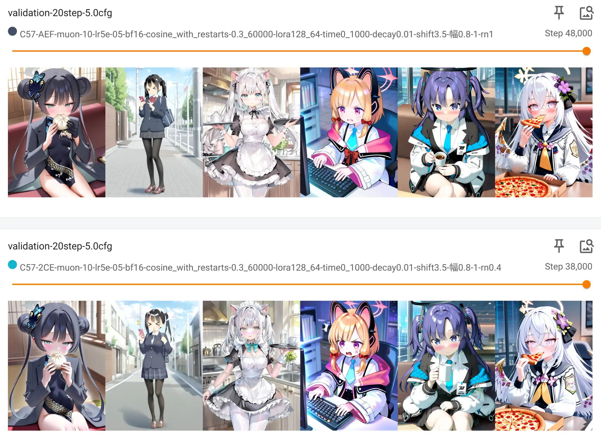
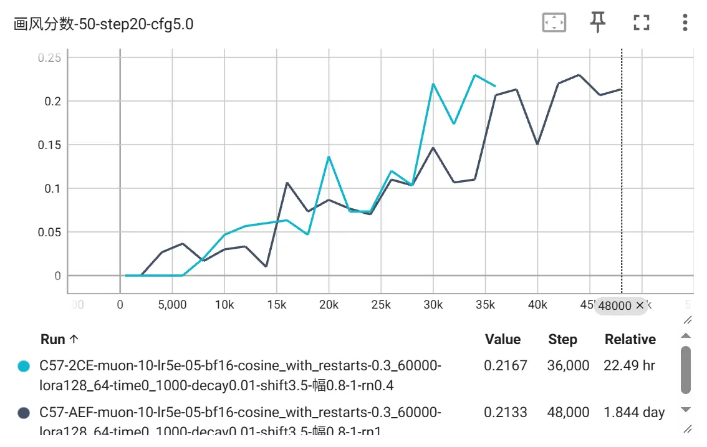

# 【RU9M】更快的扩散模型画风蒸馏！

大家有用过[RUM](https://github.com/RimoChan/RUM)吗？

之前的RUM是将动漫模型能力迁移到新模型上，不过训练还是偏慢。

最近有新出了1些不错的base model，比如krea2和moss，甚至它们本身就带有1些画动漫角色的能力，不过没有支持画风，那是不是有成本更低的方式可以把画风的能力迁移到新模型上呢？

有的！

聪明的莉沫酱最新发明的RU9M正要来解决这个问题！

## 原理

训练的时候我们通常是需要1个图和1个prompt做配对对吧，但prompt和图本身是永远对不齐的，比如图中是「白衬衫」，prompt是「衬衫」，我想让模型学习图片中的画风因此在「衬衫」后加上了`[V]`，结果模型可能反而把「白」学会了。

对于prompt来说，标注得越细致，新标记的占比就越小，标注得越粗糙，prompt和图像的偏差就越大。

那怎么办呢？

我们可以反过来想，先确定prompt，然后直接用prompt生成对应图片，他们不就对应上了吗？等等，听起来很好，可是那`[V]`怎么办？模型就是不会`[V]`才要去学啊，它能画那还学什么？

那有没有办法在不改变图片原有内容的情况下，把`[V]`添加上去呢？在画风作为`[V]`的场景中，我们一直都有1个这样的手段，那就是图像重绘！

所以流程就是这样，首先做1个简短的`prompt+V`，随机选噪声`N1`，用MOSS生成图片`A1`，然后把`prompt+V`和图片`B`送进SDXL加0.8的噪声`N2`生成图片`A2`，训练的时候就输入`prompt+V`和`N1`，结果对`A2`作loss，这样就可以了。

## 效果

现在刚训练了2天，看起来就就已经初具雏形了！下面这张图的画风从左到右分别是mignon，kani biimu，momoko (momopoco)，fuzichoco，kantoku，chen bin。

下面这个指标是画风的准确度，看起来涨点也很快，检测用的是[Kaloscope2.0](https://huggingface.co/heathcliff01/Kaloscope2.0)模型。

因为还在测试阶段，所以现在跑的这个版本不是dan上全部的画风，而是从群友处收集的128个常用画风，不过128个大抵也够用了吧。

## 成本

之前训RUM的时候花了$600，但当时RTX5090租1天只要$5，现在涨价了不少，1天要$12，好贵！

刷数阶段我先是刷了11500张图，这些花了3天。然后5090 1天能跑38000个step，现在跑了1天涨了20%的点，当然后面应该不是线性的，让我来看看能不能把成本控制在$120以内好了！

## 使用方法

1. 做数据

代码是`刷.py`。

先用krea2或moss刷1遍，然后清洗，然后SDXL重绘刷1遍。

2. 跑训练

代码是`train_moss.py`。

具体的脚本启动方式就以后再讲吧，现在应该也没有人想直接跑！

## 结束

就这样，我要去训练群友了，大家88！
